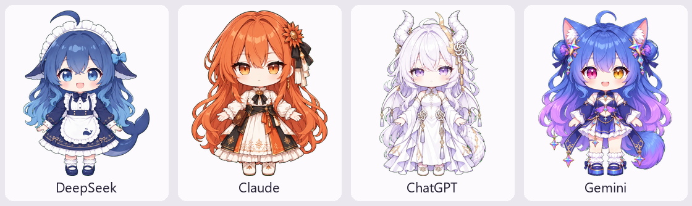

# Codex AI 智能伙伴四件套

四个 2D Q 版 Codex 桌面宠物。每个宠物包提供 57 帧动画和 16 个视线方向，使用透明的 v2 精灵图。

| 伙伴 | 造型 | 文件 |
| --- | --- | --- |
| DeepSeek | 蓝发鲸尾女仆 | [安装目录](deepseek/) · [动画预览](deepseek/preview.gif) |
| Claude | 橘发、太阳发饰 | [安装目录](claude/) · [动画预览](claude/preview.gif) |
| ChatGPT | 白发紫瞳、龙角与浅紫龙翼 | [安装目录](chatgpt/) · [动画预览](chatgpt/preview.gif) |
| Gemini | 蓝紫猫耳、星饰与粉金异色瞳 | [安装目录](gemini/) · [动画预览](gemini/preview.gif) |

## 安装

1. [下载 ZIP](https://github.com/liujunhao346-creator/codex-ai-companion-pets/archive/refs/heads/main.zip) 并解压。
2. 在 Codex 桌面应用中打开 **设置 → 宠物 → 打开文件夹**。
3. 把想安装的角色文件夹复制进去。每个文件夹内应直接包含 `pet.json` 和 `spritesheet.webp`。
4. 回到 **设置 → 宠物**，刷新并选择伙伴。也可以在 Codex 对话里用 `/pet` 唤醒。

需要支持 v2 本地宠物的 Codex 桌面版本。精灵图尺寸为 1536×2288，按 8 列×11 行排列，每格为 192×208 像素。

## 来源和许可

造型来自项目发起人提供的四张角色三视图。仓库中的动画是为 Codex 重新生成和编排的，三视参考原图未随包分发。角色名称用于标识各自的造型，这是非官方社区作品。

原创配置与文档采用 [MIT 许可证](LICENSE)。该许可证不涵盖精灵图与预览所涉及的第三方角色、原画或品牌权利。
